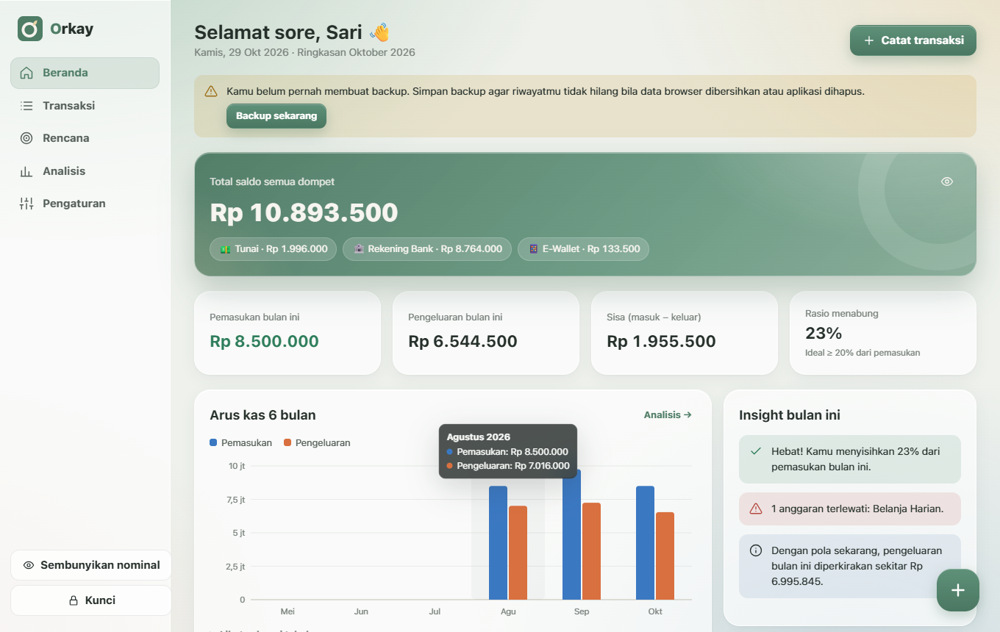
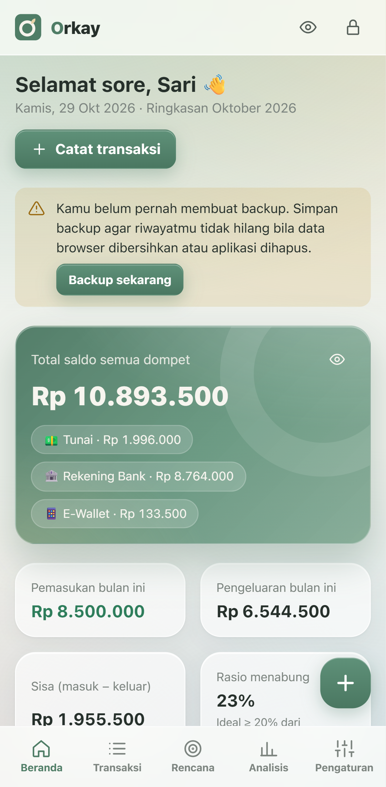
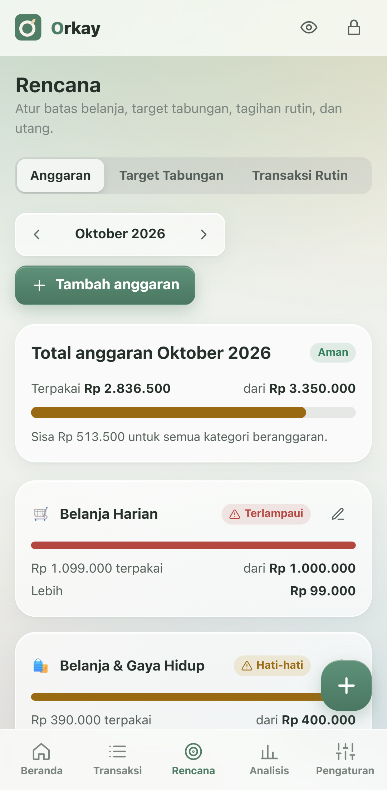
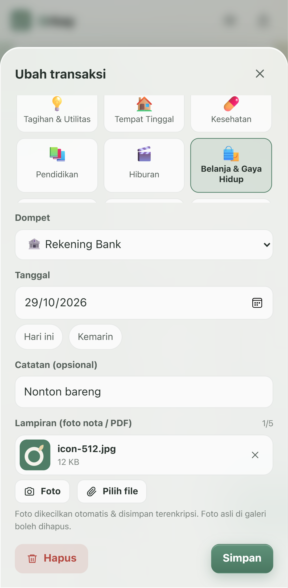
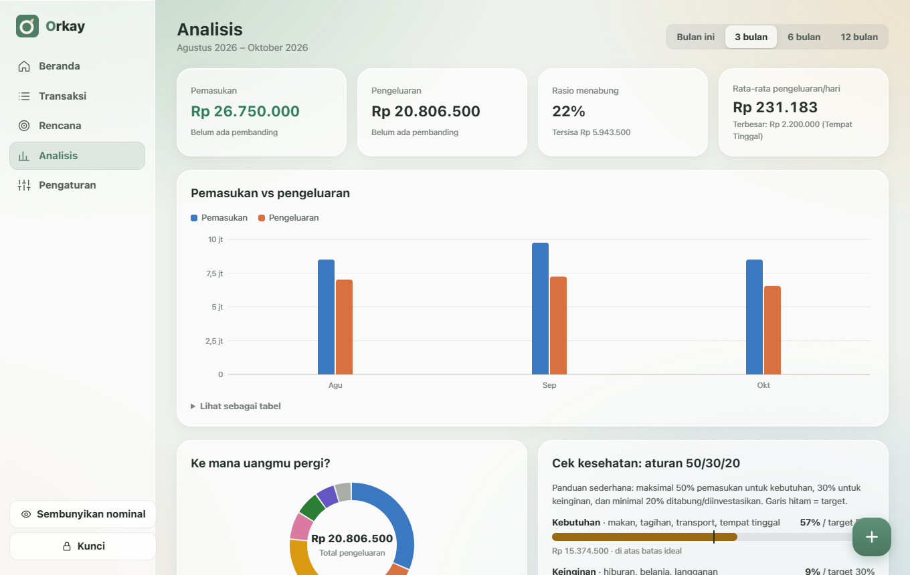
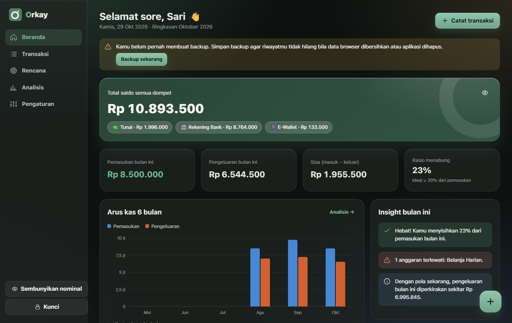

  

<h1 align="center">Orkay</h1>

  Aplikasi catatan keuangan pribadi yang <b>privat, terenkripsi, dan jalan offline</b>. 
  Tanpa akun, tanpa iklan, tanpa server. Semua data hanya ada di perangkatmu.

  <a href="https://github.com/alimxtar/orkay/releases/latest"><b>⬇️ Unduh Orkay</b></a>
  &nbsp;·&nbsp;
  <a href="docs/CARA-INSTALL.md">Cara install</a>

  

  
  
  

## Unduh

| Perangkat | File | Syarat |
|---|---|---|
| **Android** | `Orkay-1.0.0.apk` | Android 7.0+ |
| **Windows** | `Orkay-Setup-1.0.0.exe` | Windows 10/11 64-bit |
| **iPhone / iPad** | Versi web → Safari → *Tambahkan ke Layar Utama* | iOS 16.4+ |

Semua file ada di halaman **[Releases](https://github.com/alimxtar/orkay/releases/latest)**. Saat memasang akan muncul peringatan Play Protect atau SmartScreen. Ini wajar untuk aplikasi di luar Play Store; cara melewatinya ada di [panduan install](docs/CARA-INSTALL.md).

## Fitur

- **Catat transaksi:** pemasukan, pengeluaran, dan transfer antar dompet (tunai, bank, e-wallet, kartu kredit).
- **Lampiran nota:** foto struk atau PDF. Foto dikecilkan otomatis, lokasi GPS dibuang, dan file disimpan terenkripsi.
- **Rencana:** anggaran per kategori, target tabungan, transaksi rutin otomatis (gaji, sewa, langganan), serta utang & piutang.
- **Analisis:** arus kas 1–12 bulan, ke mana uang pergi, perbandingan dengan bulan lalu, cek aturan 50/30/20, dan insight otomatis.
- **Kategori bebas:** pilih emoji apa pun langsung dari keyboard.
- **Dua bahasa:** Indonesia & English.
- **Tampilan:** tema terang/gelap dan gaya kaca lembut ala iOS.
- **Backup:** file terenkripsi untuk pindah ke HP/laptop lain, plus ekspor ke Excel (CSV).

  
  

## Privasi & keamanan

- **Tidak ada data yang dikirim ke internet.** Tidak ada server, akun, iklan, maupun pelacak.
- **Data terenkripsi** dengan AES-256 memakai kunci dari kata sandimu (PBKDF2, 600.000 iterasi).
- **Kunci otomatis** saat aplikasi tidak dipakai, plus tombol untuk menyembunyikan nominal di tempat umum.

> **Kata sandi tidak bisa dipulihkan**, karena datanya benar-benar terenkripsi. Rutinlah membuat backup di *Pengaturan → Unduh backup*.

## Masukan

Temukan bug atau punya ide fitur? Buka **[Issues](https://github.com/alimxtar/orkay/issues)**.

## Developer

**Ali Mochtar Ahdina S.**, [github.com/alimxtar](https://github.com/alimxtar)

## Lisensi

Hak cipta © 2026 Ali Mochtar Ahdina S. Seluruh hak dilindungi.
Aplikasinya gratis untuk dipakai pribadi. Kode sumber, desain, dan logonya tidak boleh disalin atau didistribusikan ulang tanpa izin. Lihat [LICENSE](LICENSE).
